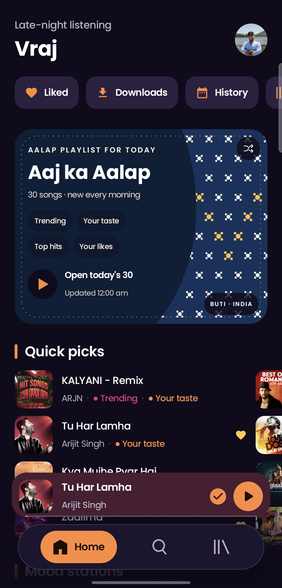

<p align="center">
  
</p>

# Aalap

**All your music. One app.** Aalap is an Android music player built with Jetpack Compose.
It brings your library, playlists and likes into one place and plays them with no ads,
in high quality, with lyrics and offline listening.

## Features

- **One Aalap account.** Sign up once with your name and email, then connect your music
  services. You can change your name in Profile.
- **Your library, your way.** Playlists, liked songs, followed artists, albums and
  local files. Edits stay in sync.
- **Plays everywhere.** Several audio sources race each other in the background, so a
  song keeps playing when one source is slow. You only ever see Aalap.
- **Daily Home.** Mood mixes, charts, fresh picks and your favourites, refreshed through the day.
- **Smart radio.** Up next blends several recommendation feeds with your own listening
  habits.
- **Lyrics.** Synced, karaoke-style lyrics. Share any line as a card.
- **Replay.** Your top artists and songs and minutes listened, by month and year. Also a
  Wrapped-style recap.
- **Sound.** Equalizer presets, speed control, crossfade and fast loading.
- **Offline.** Download songs and playlists, up to 320 kbps.
- **Voice.** "Hey Google, play Kesariya on Aalap", "play party songs on Aalap", "play my
  liked songs on Aalap": works with Google Assistant, Gemini and Bixby, and in the car.
- **Widgets and notifications.** Play/pause, skip, like and shuffle from the home screen and
  the notification shade.
- **Light and dark themes** in the Aalap saffron and indigo palette.

## Screenshot



## Build

Requirements: Android Studio (Ladybug or newer), JDK 17, Android SDK 34.

```bash
./gradlew :app:assembleDebug
```

To build a signed release, see `scripts/sign-release.sh`.

Project layout:

| Module | Purpose |
|---|---|
| `app` | The Aalap app (Compose UI, player, recommendations, sources) |
| `innertube` | Trimmed YouTube Music client |
| `spotify` | Catalogue client |

## License

Copyright © 2025–2026 Vraj Chauhan.

Aalap is free software under the **GNU General Public License v3.0**. See
[LICENSE](LICENSE) and [NOTICE](NOTICE). You may use, change and share it, including for
your own personal use, under the terms of that license.

## Credits

Aalap builds on these open-source projects:

- [Neptune](https://github.com/navneet851/spotify-clone-jetpack-compose): the original Compose music app this project started from
- [Metrolist](https://github.com/MetrolistGroup/Metrolist): the YouTube Music innertube client
- [SimpMusic](https://github.com/maxrave-dev/SimpMusic): crossfade and audio filter processing

## Disclaimer

Aalap is an independent project and is not affiliated with or endorsed by any streaming
service. All trademarks belong to their owners.
